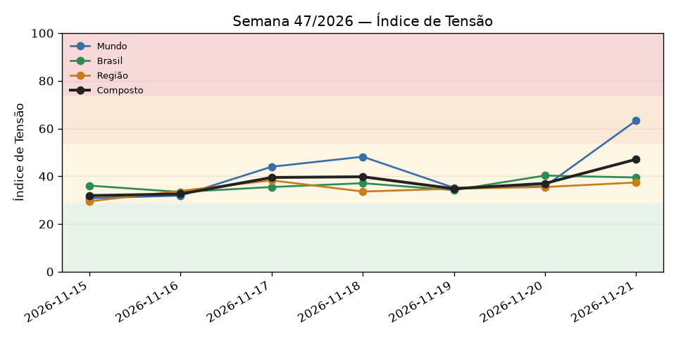

# Palavra da Semana — semana 47/2026

Preparando **Nosso Senhor Jesus Cristo, Rei do Universo, Solenidade** (domingo, 22 de novembro de 2026) · Tempo Comum · Ano A

## A semana em uma frase

A semana registrou tensões marítimas, mobilizações eclesiásticas e desafios climáticos, com um movimento de crescimento em diversas áreas.

Medidor ao fim da semana: composto **47** (atenção) · mundial **63** (tensão) · nacional **40** (atenção) · regional **37** (atenção) · tendência **em alta**

Temas que voltaram ao longo dos dias:

- Ataques marítimos em Marítimo de Hormuz (1 dia)
- Papa em Roma, viagem pela América do Sul (2 dias)
- Ceará entra em emergência por efeitos do El Niño (1 dia)

## Evangelho do domingo — Mt 25,31-46

Jesus descreve o julgamento final, onde os justos são recompensados e os injustos castigados, baseado em atos de misericórdia e solidariedade.

## A Palavra da Semana — Mt 9,13 (MS)

> Ide, e aprendei o que significa: Quero misericórdia e não sacrifício (Os. 6, 6). Porque eu não vim chamar os justos, mas os pecadores."

Diz a Escritura: “Ide, e aprendei o que significa: Quero misericórdia e não sacrifício (Os. 6, 6).” (Mt 9,13). Jesus redefiniu a essência do serviço religioso, priorizando a misericórdia sobre rituais externos. A mensagem é clara: o verdadeiro culto é transformar vidas, não apenas cumprir obrigações.

O evangelho de hoje, Mt 25,31-46, descreve o julgamento final baseado em atos de misericórdia. Os justos são recompensados por terem ajudado os necessitados, enquanto os injustos são castigados por terem ignorado o sofrimento alheio. Isso reforça que a fé se manifesta em ações concretas.

No contexto atual, a Palavra nos convida a refletir: como responderemos aos desafios do dia? A violência e a crise climática exigem solidariedade, enquanto a visita do Papa oferece um exemplo de esperança. A misericórdia, como diz Mt 9,13, é o caminho para um mundo mais justo e fraterno.

Que hoje escolhamos viver a misericórdia: ouça o que precisa ser dito, ajude quem está sozinho e promova a justiça. Que a fé nos motive a transformar o mundo, com a graça de Jesus, nosso Rei e Salvador.

**Ensinamento:** Pratique a misericórdia diariamente, mesmo nas pequenas coisas.

**Gesto da semana:** Ofereça ajuda a alguém em necessidade, mesmo que seja um gesto simples, como um sorriso ou um ouvido atento.

## Plano de leitura

- **Seg 23/11** — 2Cor 5,17-21 (MS) · Evangelho do dia: Lc 21,1-4 · *Ataques marítimos em Marítimo de Hormuz*
- **Ter 24/11** — Ef 4,13-17 (MS) · Evangelho do dia: Lc 21,5-11 · *Papa em Roma, viagem pela América do Sul*
- **Qua 25/11** — Eclo 1,38-40 (MS) · Evangelho do dia: Lc 21,12-19 · *Ceará entra em emergência por efeitos do El Niño*
- **Qui 26/11** — Eclo 27,21-23 (MS) · Evangelho do dia: Lc 21,20-28 · *Ataques marítimos em Marítimo de Hormuz*
- **Sex 27/11** — At 28,11-18 (MS) · Evangelho do dia: Lc 21,29-33 · *Papa em Roma, viagem pela América do Sul*
- **Sáb 28/11** — Rm 13,10-14 (MS) · Evangelho do dia: Lc 21,34-36 · *Ceará entra em emergência por efeitos do El Niño*
- **Dom 29/11** — Eclo 22,27-29 (MS) · Evangelho do dia: Mc 13,33-37 · *Ataques marítimos em Marítimo de Hormuz*

## Para partilhar

1. Como podemos mostrar solidariedade com quem sofre com os efeitos do El Niño no Ceará?
2. Quais atos de misericórdia podemos praticar em resposta a conflitos globais?
3. Como a viagem do Papa pela América do Sul nos inspira a ação compassiva?

## Oração da semana

Senhor, ensina-nos a ver o mundo com os olhos da misericórdia. Guia-nos para que nossas ações reflitam tua justiça e teu amor. Que a paz que nos deste se manifeste em cada gesto de compaixão. Amém.

---

Texto bíblico: Bíblia Sagrada, trad. Pe. Manuel de Matos Soares (1956) · Leituras: Liturgia Diária · O índice de tensão é um sinal automático (léxico e tradução de máquina), não uma verdade · Fiat Lux v0.1.0
